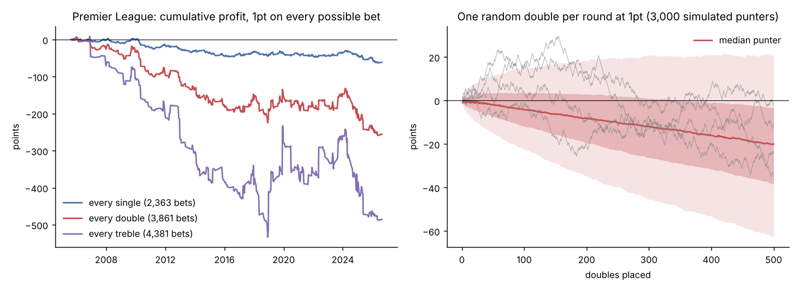

# Do doubles and trebles of ~1.5 shots make money? Backtest verdict

**No. At scale the theory loses, and combining legs makes the loss rate worse, not better.**

Staking: level stakes, 1 point per bet (the standard convention). ROI = profit / points staked.
A £20 double is a 1-point bet with 1pt = £20; stake size scales the pounds won or lost but never the ROI.
A "leg" is any home win, away win, over 2.5 or under 2.5 priced 1.40-1.60, max one per match.

## Headline

| Sample | Bet | Bets | Strike rate | ROI | 95% CI |
|---|---|---|---|---|---|
| Premier League 2005-2026 | singles | 2,363 | 64.5% | -2.6% | -5.5 to +0.4 |
| | doubles | 3,861 | 41.1% | -6.6% | -13.4 to +0.2 |
| | trebles | 4,381 | 26.0% | -11.1% | -24.1 to +3.1 |
| 38 leagues 2005-2026 | singles | 55,866 | 63.2% | -3.9% | -4.5 to -3.3 |
| | doubles | 1,855,097 | 40.0% | -7.6% | -8.8 to -6.3 |
| | trebles | 44,625,074 | 25.4% | -11.1% | -13.1 to -9.1 |

In money: £20 on each of the 3,861 Premier League doubles stakes £77,220 and loses about £5,100.

## Why

- The bookmaker margin on these markets averages about 4.5%. Every leg carries it, and a multiple
  multiplies the legs, so the margin compounds: roughly -4% per single, -8% per double, -12% per treble.
  The measured numbers match that arithmetic almost exactly.
- A double at 1.5 x 1.5 = 2.25 needs to win 44.4% of the time to break even. It wins 40-41%.
- A bigger stake on a multiple does not change the edge. It only makes the swings bigger.

## Why it "seems to work at the minute"

Simulating punters placing one random double a round: 41% are in profit after 10 doubles, 47% after 20,
41% after 50, 36% after 100, and still 21% after 500. A winning run of a few months is close to a coin
flip and says very little. 8 of the 22 Premier League seasons were profitable for doubles.

## Things that did not rescue it

- **Odds bands** (1.20 up to 2.10): every band loses on singles and doubles across all leagues.
- **Markets**: Premier League away favourites were +2.1% on singles (408 bets, CI -4.7 to +8.9),
  which is noise; across all leagues away favourites lose.
- **Contextual filters** (market, odds half-band, Elo lead, form, time of season, and pairs of these):
  filters were chosen on seasons up to 2017 and judged on 2018 onwards. Across all leagues, 0 of 51
  filters were profitable even in the period they were chosen on. In the Premier League alone, 17 of 54
  looked profitable in-sample and several stayed positive afterwards, but on 50-200 legs each with
  confidence intervals like -57% to +75%. None is distinguishable from luck, and none survives in
  the 20x larger all-league sample.

## The one thing that moved the needle

Taking the **best price in the market** on every leg instead of one bookmaker's price brings all
leagues to roughly break-even: singles -0.2%, doubles -0.3%, trebles -0.3% (PL doubles -0.3%).
That is an upper bound, since you will not get top price on every leg and bookmakers limit accounts
that consistently take it. It turns a steady loss into roughly zero, not into a profit.

## Caveats

- Odds are pre-match prices as recorded in the dataset (derived from football-data.co.uk), not
  guaranteed closing prices and not your specific bookmaker.
- "Every possible double in a round" weights busy rounds heavily; the equal-weight
  "one random double per round" figure is also negative (PL -4.1%, all leagues -7.2%).
- Elo and form figures come from the dataset and are assumed to be pre-match values.
- Only match result and over/under 2.5 are covered. No BTTS, handicaps or bet-builder prices.

Full tables: `results/tables.md`. Re-run everything: `python src/run.py`.
